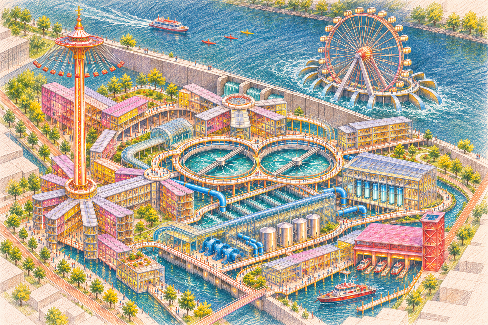
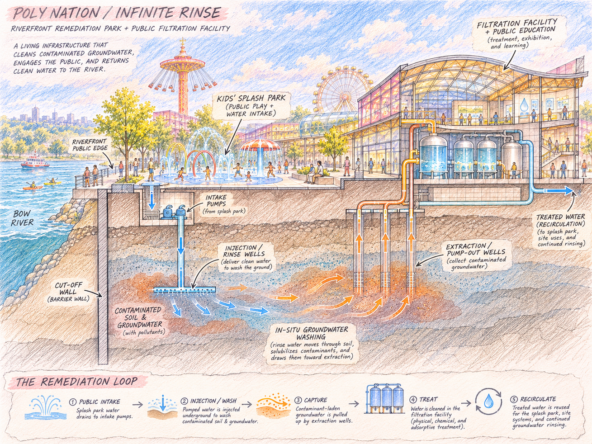
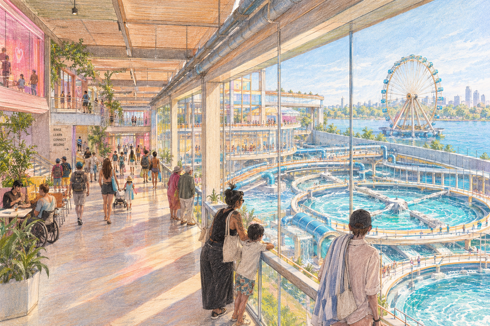
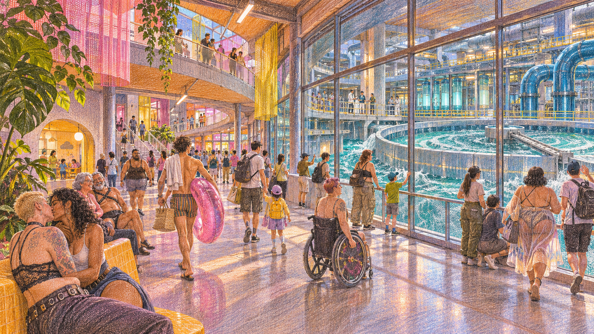

# Poly Nation

**ARCH 606 – Studio III · Vian Esterhuizen**

Poly Nation is a "pollination" of programs: a radically mixed-use, modular waterfront district on the Bow River in Calgary. It layers **Sex** (love hotel), **Support** (senior care, daycare) and **Safety** (marine firehall) alongside **Infinite Rinse**, a public water-treatment facility and museum that remediates creosote-contaminated ground. Play, eroticism, hedonism and pleasure are treated as productive forces.

## Concept

- **Pixel farm** – the whole district is assembled from one repeating modular unit, with programs distinguished by colour.
- **Hubs** – radial "sunflower" clusters of linear modules around a central core; one hub is anchored by a tall tower with a swing-ride crown.
- **Site plan** – (1) modular hubs, (2) distributed modules, (3) midway rides, plus a ferris wheel in the river.
- **Context** – the Fifth City studio brief, concerned with creosote contamination along the Bow River.

## Program

Total target: **20,000 m² GFA**.

| Program | GFA | Share | ≈ Modules (÷ 81 m²) |
| --- | --- | --- | --- |
| Infinite Rinse – water treatment and museum | 7,500 m² | 37.5% | 92.6 |
| Love hotel | 8,000 m² | 40% | 98.8 |
| Marine firehall | 1,500 m² | 7.5% | 18.5 |
| Daycare | 1,000 m² | 5% | 12.3 |
| Senior care | 2,000 m² | 10% | 24.7 |
| **Total** | **20,000 m²** | **100%** | **≈ 246.9** |

## Modular unit

| Dimension | Value |
| --- | --- |
| Width | 4.5 m |
| Length | 18 m |
| Height | 4 m |
| Footprint | 81 m² |

20,000 m² ÷ 81 m² ≈ 247 modules. Rounded per program (93 / 99 / 19 / 12 / 25 = 248 modules) the total is 20,088 m², so exactly 20,000 m² requires about 247 modules or deliberately non-modular space. Module counts count floor area; stacked modules count each level.

## Infinite Rinse

A water treatment facility and museum that remediates creosote through continuous circulation and filtration of water:

1. **Public intake** – the kids' splash park drains to intake pumps.
2. **Injection / rinse wells** – wash contaminated soil and groundwater.
3. **Extraction / pump-out wells** – capture contaminant-laden water.
4. **Treatment** – physical, chemical and adsorptive.
5. **Recirculation** – treated water returns to the splash park, site uses and continued rinsing.

A cut-off barrier wall protects the riverfront. Clean water is demonstrated publicly, with surfactant added downstream before re-injection. Recreation (water park, log ride) is part of the remediation infrastructure, and the facility includes public education and exhibition space.

## Design strategies (Phase 3 reflection)

Flexible architecture risks needing massive machinery, which undermines play. Strategies:

- Small-scale, hands-on changeability: movable benches, tables and fire pits; bike racks that turn into games.
- Empty module slots become communal patios or balconies.
- Colour-coded structural supports that can host bird nests.
- Easily modifiable facades in colour and material.

## Drawings

Phase 2 includes south and east elevations (1:500), the firehall plan (1:200, boat bays and river dock), a sample 2-bedroom residential module plan (1:50) and a physical site model.

## Repository contents

- `docs/images/` – renderings and diagrams
- `docs/pdfs/phase-2.pdf` – Phase 2 drawings
- `docs/pdfs/phase-3-reflection.pdf` – Phase 3 reflection
